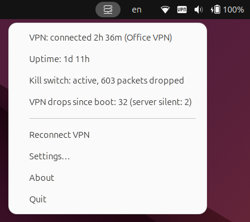
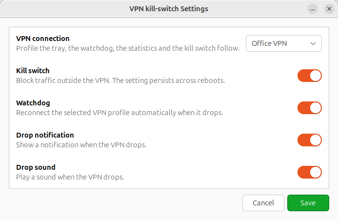
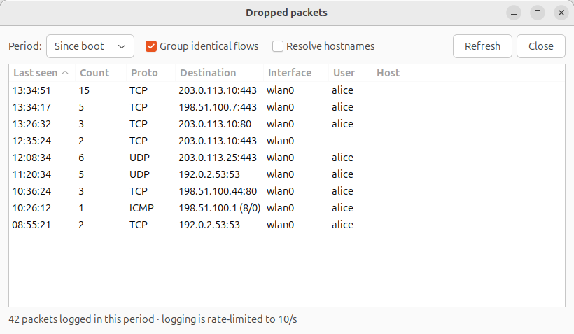
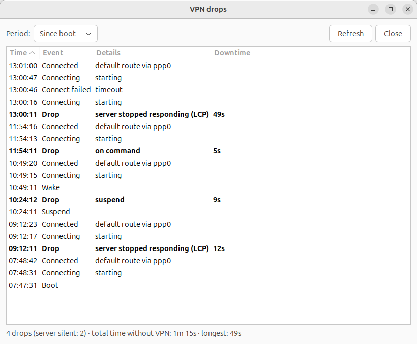
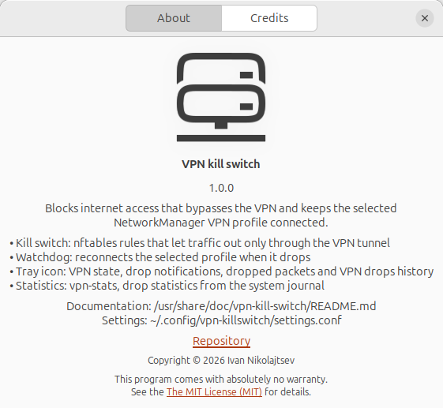

# VPN kill switch for NetworkManager VPN profiles

Blocks internet access that bypasses the VPN. While the VPN tunnel is down or
not yet established, the only traffic that leaves the machine is what the VPN itself
needs to come up, plus local-network traffic. Everything else is dropped.

Works with any NetworkManager VPN profile: L2TP/IPsec, PPTP, OpenVPN, WireGuard, IKEv2
and so on. The profile is not hard-coded: you choose it in the Settings window of the
tray icon, and that choice drives the tray, the watchdog, the statistics command and the
VPN server addresses the kill switch lets through.

Built for Ubuntu with NetworkManager and installed as a single Debian package. Implementation: a single
nftables table, a systemd unit that loads it at boot and a small root helper that keeps the VPN server
addresses up to date.

Repository: <https://github.com/localhost1982/vpn-kill-switch>

Download: [vpn-kill-switch_1.0.0_all.deb](https://github.com/localhost1982/vpn-kill-switch/releases/download/v1.0.0/vpn-kill-switch_1.0.0_all.deb)
(the latest version is always on the [Releases page](https://github.com/localhost1982/vpn-kill-switch/releases/latest)).
What changed between versions: [CHANGELOG.md](CHANGELOG.md).

## Screenshots

The windows of the tray icon (the data in the screenshots is made up).

The tray menu: the VPN state, the kill switch state and the drop counters (click the icon in the top bar).



Settings: the VPN profile, the kill switch, the watchdog and the drop notification and sound (menu `Settings…`).



Dropped packets: what the kill switch blocked, grouped by destination (click the `Kill switch: …` line of the menu).



VPN drops: the chronology of drops and reconnections with the cause and the downtime (click the `VPN drops since boot: …` line of the menu).



About: the version, the components and the paths of the documentation and settings (menu `About`).



## Contents

The repository:

| File | Purpose |
|---|---|
| `killswitch.nft` | Generic nftables rules. |
| `vpn-killswitch.service` | systemd unit that loads the rules before the network comes up. |
| `vpn-killswitch-server.sh` | Root helper that resolves the VPN server host names and writes the allowed server addresses. |
| `vpn-stats.sh` | Statistics of VPN drops and internet outages of the selected profile for the last N hours. |
| `tray/vpn-tray.py` | VPN icon in the GNOME top bar with a statistics menu, VPN drop notifications and the Settings window (VPN profile, kill switch, watchdog, notifications). |
| `tray/vpn-tray.service` | `systemd --user` unit that starts the icon after you log in to the session. |
| `watchdog/vpn-watchdog.sh` | Keeps the selected VPN profile connected: checks every 3 s and brings it up if it is down. |
| `watchdog/vpn-watchdog.service` | `systemd --user` unit that runs the watchdog. |
| `VERSION` | The version of the project and of the package (one line). The About window shows it. |
| `packaging/build-deb.sh` | Builds the Debian package into `dist/` (see "Building the package"). |
| `packaging/control.in` | Template of the package's `control` file (dependencies, description). |
| `packaging/preinst`, `postinst`, `prerm`, `postrm` | Maintainer scripts of the package. |
| `packaging/sudoers` | The sudoers drop-in with the passwordless rights for the `sudo` group. |
| `packaging/conffiles` | The list of configuration files that dpkg protects on upgrade. |
| `docs/screenshots/` | The screenshots shown in this README. |
| `LICENSE` | The MIT License. |
| `CHANGELOG.md` | What changed in each version. |

Installed as (the layout is defined in `packaging/build-deb.sh`):

| Repository file | Installed as | Mode |
|---|---|---|
| `killswitch.nft` | `/etc/nftables.d/killswitch.nft` (conffile) | 0644 |
| `vpn-killswitch.service` | `/usr/lib/systemd/system/vpn-killswitch.service` | 0644 |
| `vpn-killswitch-server.sh` | `/usr/sbin/vpn-killswitch-server` | 0755 |
| `vpn-stats.sh` | `/usr/bin/vpn-stats` | 0755 |
| `tray/vpn-tray.py` | `/usr/lib/vpn-kill-switch/vpn-tray.py` | 0755 |
| `tray/vpn-tray.service` | `/usr/lib/systemd/user/vpn-tray.service` | 0644 |
| `watchdog/vpn-watchdog.sh` | `/usr/lib/vpn-kill-switch/vpn-watchdog.sh` | 0755 |
| `watchdog/vpn-watchdog.service` | `/usr/lib/systemd/user/vpn-watchdog.service` | 0644 |
| `VERSION` | `/usr/lib/vpn-kill-switch/VERSION` | 0644 |
| `packaging/sudoers` | `/etc/sudoers.d/vpn-kill-switch` (conffile) | 0440 |
| `README.md` | `/usr/share/doc/vpn-kill-switch/README.md` | 0644 |
| `docs/screenshots/*.png` | `/usr/share/doc/vpn-kill-switch/docs/screenshots/` | 0644 |
| `LICENSE` | `/usr/share/doc/vpn-kill-switch/copyright` | 0644 |
| `CHANGELOG.md` | `/usr/share/doc/vpn-kill-switch/CHANGELOG.md` | 0644 |

Files created while the kill switch is used (they are not part of the package):

- `/etc/nftables.d/killswitch-server.nft` and `/etc/vpn-killswitch/servers`: the VPN server addresses
  and the saved host names, written by the helper (see "Where the VPN server addresses come from");
- `~/.config/vpn-killswitch/settings.conf`: the settings of each user, written by the tray (see "Settings").

## Why you need it

A VPN has two unpleasant failure modes.

1. **The tunnel "hangs".** The tunnel interface (for example `ppp1`) is alive and the
   default route points into it, but the server is silent. Traffic goes into the void.
   This is inconvenient, but nothing leaks out.
2. **The tunnel dies and NetworkManager notices.** It removes the tunnel interface, and the default
   route falls back to Wi-Fi. From then on all traffic, DNS included, goes straight
   to the internet until the VPN is reconnected by hand. This is the leak.

The kill switch covers the second case: even when the default route points
to Wi-Fi, the rules let nothing out except VPN service packets.

## Status and limitations

- **Tested.** Live on one machine: Ubuntu 24.04, GNOME 46 (Wayland session, the tray runs under XWayland) and an
  L2TP/IPsec profile (nm-l2tp). The package install, upgrade, remove and purge cycle is tested in a clean
  Ubuntu 24.04 container. OpenVPN, WireGuard, IKEv2 and PPTP profiles are supported by the code (the extraction of
  the server address is covered by tests) but have not been run against a real server.
- **Desktop.** GNOME Shell with the AppIndicator extension is needed for the tray icon (it is enabled by default on
  Ubuntu). Other desktops are untested.
- **IPv4 only.** The list of VPN server addresses holds IPv4 addresses. While the kill switch is on, IPv6 traffic
  leaving through a physical interface is blocked, except link-local (`fe80::/10`, `ff00::/8`).
- **The kill switch blocks the internet whenever the VPN is down.** To turn it off: tray, `Settings…`, switch
  `Kill switch` off, `Save`; or, without the tray, `sudo systemctl disable --now vpn-killswitch.service`.
- **Privileges.** The package lets the members of the `sudo` group run four specific commands without a password
  (see [what the installation does](#3-what-the-installation-does-and-does-not-do)).
- **Profiles that ask for a password on every connection** cannot be reconnected by the watchdog unattended: it
  has no way to enter the password.
- **Feedback.** Issues are welcome: <https://github.com/localhost1982/vpn-kill-switch/issues>. Please mention the
  VPN type and the desktop.

## How it works

The rules live in a separate table, `inet killswitch`, with two chains. They are generic:
nothing in them depends on a particular VPN profile or protocol.

**The `output` chain** (the laptop's own traffic). The following pass without restrictions:

- `lo`;
- the tunnel interfaces `ppp*`, `tun*`, `tap*` and `wg*` (L2TP/IPsec, PPTP, OpenVPN,
  WireGuard and so on);
- `docker0`, `br-*`, `veth*`, that is, Docker.

For any other interface (Wi-Fi, Ethernet, USB modem, anything that appears later)
only the following is allowed:

- DHCP (UDP 68 → 67);
- any traffic to the VPN server addresses (the `vpn_server` set): IKE/ESP, L2TP, PPTP/GRE,
  OpenVPN, WireGuard. This is a single rule, `ip daddr @vpn_server accept`, so no
  protocol-specific ports are needed. The set holds IPv4 addresses only;
- local networks: `10.0.0.0/8`, `172.16.0.0/12`, `192.168.0.0/16`, `169.254.0.0/16`, `224.0.0.0/4`;
- IPv6 link-local (`fe80::/10`, `ff00::/8`), so that NDP works.

Everything else is dropped by the `counter drop` rule. Its counter shows
how many packets have been blocked.

Before each `drop` there is a `log` rule: `limit rate 10/second burst 20 packets log prefix "KS-DROP: "
flags skuid level info`. It writes the dropped packets to the kernel log (and so to the journal),
at most 10 lines per second (a burst of 20), so a flood of blocked packets cannot fill the journal.
The counter is not limited and stays exact. For the `output` chain the line also carries the UID of
the sending user (`flags skuid`). To see what was blocked, use the tray's "Dropped packets" window
(see "Tray icon") or:

```bash
journalctl -k --grep KS-DROP
```

**The `forward` chain** (traffic the laptop forwards, i.e. Docker containers).
Containers may go out through the tunnel interfaces, talk to each other over the Docker bridges and reach
the local network. They cannot reach the internet directly, bypassing the VPN. Its `drop` is preceded by
the same kind of rate-limited `log` rule, with the prefix `KS-DROP-FWD: ` (no UID: the sender is a container).

The table does not depend on whether NetworkManager noticed the VPN failure. The rules
are static and always in effect.

### Where the VPN server addresses come from

`killswitch.nft` starts with `include "/etc/nftables.d/killswitch-server.nft"`, a generated
file with a single line of the form `define vpn_servers = { 203.0.113.10 }`, and builds the
`vpn_server` set from `$vpn_servers`. That file must not be edited by hand. It is written by
the helper `/usr/sbin/vpn-killswitch-server` (installed from `vpn-killswitch-server.sh`),
which runs as root:

```
vpn-killswitch-server set HOST [HOST...]   resolve the VPN server host(s) and update the kill switch
vpn-killswitch-server refresh              re-resolve the saved hosts and update the kill switch
vpn-killswitch-server show                 show the saved hosts and the current define line
```

- `HOST` is a host name or an IPv4 address. The hosts are validated, all of them are
  resolved first, and nothing is written if any host cannot be resolved.
- The saved hosts (one per line) are kept in `/etc/vpn-killswitch/servers`, the resolved
  addresses in `/etc/nftables.d/killswitch-server.nft`. `set` replaces the whole list.
- The new rules are checked with `nft -c`. If nft rejects them, the previous files are
  restored. If `vpn-killswitch.service` is active, it is reloaded; otherwise the helper
  prints `Kill switch is not active; files updated, rules will apply on next start.`
- Exit codes: 0 ok, 1 general error, 2 invalid usage or host, 3 cannot resolve a host,
  4 nft rejected the new rules, 5 the service reload failed.
- For testing without root: `VKS_PREFIX=/some/dir` is prepended to all `/etc` paths and
  `VKS_DRY_RUN=1` skips the root check, `nft -c` and `systemctl`.

The package does not ship the generated file. The server addresses are written when you pick a VPN
profile and press `Save` in the tray Settings window: the tray calls
`sudo -n /usr/sbin/vpn-killswitch-server set HOST...` with the server hosts of that profile (see "Settings").
That is why the first `Save` after the installation both selects the profile and prepares the kill switch.
You can also run the helper by hand with `sudo`.

Host names are resolved when `set` runs. If the server's IP address changes later,
run `sudo vpn-killswitch-server refresh` (see "Changing the rules").

### Why not `nftables.service`

The stock `/etc/nftables.conf` starts with `flush ruleset`. If you enable
`nftables.service`, it wipes the Docker rules (Docker works through
iptables-nft) and ufw at boot. That is why a dedicated unit is used: it loads only
its own table and leaves the others alone. The rules file is idempotent: on every load
the `inet killswitch` table is recreated, and all other tables stay as they were.

## Requirements

- Ubuntu 24.04 with GNOME and NetworkManager. The packages the project needs (nftables, systemd, the Python
  and GTK bindings of the tray and so on) come as dependencies of the Debian package (see "Installation");
- nftables (`nft`) and systemd;
- a VPN through NetworkManager with a tunnel interface named `ppp*`, `tun*`, `tap*` or `wg*`
  (nm-l2tp, nm-pptp, OpenVPN, WireGuard, strongSwan IKEv2 with a virtual interface and so on).
  If your VPN uses another interface name, add it to the `oifname` lists in both chains of
  `killswitch.nft`;
- ufw is disabled or does not interfere (the kill switch table works independently of it).

## Installation

The project is installed as a single Debian package (Ubuntu 24.04).

### 1. Get the package

Either download `vpn-kill-switch_<version>_all.deb` from the
[Releases page](https://github.com/localhost1982/vpn-kill-switch/releases/latest) of the repository, or build it
yourself (see "Building the package"). The package is architecture-independent (`all`).

The current release is 1.0.0:
[vpn-kill-switch_1.0.0_all.deb](https://github.com/localhost1982/vpn-kill-switch/releases/download/v1.0.0/vpn-kill-switch_1.0.0_all.deb).
From a terminal:

```bash
wget https://github.com/localhost1982/vpn-kill-switch/releases/download/v1.0.0/vpn-kill-switch_1.0.0_all.deb
```

Each release lists the SHA-256 checksum of its file; compare it with the downloaded one:

```bash
sha256sum vpn-kill-switch_1.0.0_all.deb
```

### 2. Install it

```bash
sudo apt install ./vpn-kill-switch_1.0.0_all.deb
```

The `./` is needed: it tells apt that the argument is a file. apt also installs the dependencies.

**Depends** (always installed): `nftables`, `network-manager`, `systemd`, `sudo`, `python3`, `python3-gi`,
`gir1.2-gtk-3.0`, `gir1.2-nm-1.0`, `gir1.2-ayatanaappindicator3-0.1`. Most of them are already present
in Ubuntu; the last four are the GTK, NetworkManager and AppIndicator bindings of the tray icon.

**Recommends** (apt installs them by default; the tray works without them):

- `gir1.2-notify-0.7`: the VPN drop notification popup (see "Drop notifications");
- `gnome-session-canberra`: `canberra-gtk-play`, the VPN drop sound;
- `gnome-shell-extension-appindicator`: the AppIndicator extension of GNOME Shell, without which the
  tray icon does not appear (see "Tray icon").

### 3. What the installation does and does not do

It does:

- install the files listed in "Contents";
- install the sudoers drop-in `/etc/sudoers.d/vpn-kill-switch` for the members of the `sudo` group, so no
  manual `visudo` is needed any more:

  ```
  %sudo ALL=(root) NOPASSWD: /usr/sbin/nft list chain inet killswitch output
  %sudo ALL=(root) NOPASSWD: /usr/bin/systemctl enable --now vpn-killswitch.service
  %sudo ALL=(root) NOPASSWD: /usr/bin/systemctl disable --now vpn-killswitch.service
  %sudo ALL=(root) NOPASSWD: /usr/sbin/vpn-killswitch-server *
  ```

  What each rule enables (the tray runs its commands through `sudo -n`, it must never ask for a password):

  1. `nft list chain inet killswitch output`: reading the exact nftables blocked-packet counter. Only
     `vpn-stats` needs it (the "Blocked by kill switch, packets" row); the tray does not use it:
     the `Kill switch: …` menu line counts the packets logged in the kernel journal. The rule allows
     exactly one command. Without it `vpn-stats` shows `n/a (sudo required)` in that row and
     everything else works.
  2. `systemctl enable --now vpn-killswitch.service`: turning the kill switch on with the toggle
     in Settings.
  3. `systemctl disable --now vpn-killswitch.service`: turning it off with the toggle.
  4. `vpn-killswitch-server *`: changing the VPN profile in Settings (the tray runs the helper's
     `set` command). It also lets you run `sudo vpn-killswitch-server refresh` without a password.
     The helper validates every host argument, but note that this rule lets the members of the `sudo`
     group change which servers are reachable outside the tunnel.

  The file is a conffile: dpkg keeps your changes to it on upgrade. A user who is not in the `sudo` group
  gets no passwordless rights: the tray shows the hints described in "Settings" and `Save` does not work
  (see "Troubleshooting");
- enable the user units `vpn-tray.service` and `vpn-watchdog.service` for all users
  (`systemctl --global enable`), so they start at every login, and start them right away for the users who
  are logged in now (the watchdog always, the tray when the graphical session is running);
- print `VPN kill switch installed. Open the tray icon → Settings…, choose the VPN profile and turn the kill switch on.`

It does not:

- **enable the kill switch.** `vpn-killswitch.service` stays disabled and no rules are loaded, so the
  network works as before until you turn the kill switch on yourself (step 4);
- choose a VPN profile. Until you do, the watchdog has nothing to do;
- change the rules of Docker, ufw or any other nftables table (see "Why not `nftables.service`").

### 4. First run

1. The tray icon appears in the top bar (if it does not, see "Troubleshooting"). With no profile chosen it
   shows `VPN: not selected`.
2. Open the menu and choose `Settings…`.
3. In the `VPN connection` dropdown choose your VPN profile and turn the `Kill switch` toggle on.
4. Press `Save`.

The kill switch can only be turned on with a selected VPN profile: without one, `Save` shows
`Select a VPN profile first: the kill switch needs to know the VPN server.` and does nothing else.

`Save` runs the following steps one after another (details and error messages in "Settings"):

1. takes the server hosts of the chosen profile and runs
   `sudo -n /usr/sbin/vpn-killswitch-server set HOST...`: this creates the list of VPN server addresses
   that the kill switch lets through;
2. writes the profile to `~/.config/vpn-killswitch/settings.conf`;
3. brings the old profile down (if it was active) and starts the new one in the background;
4. runs `sudo -n systemctl enable --now vpn-killswitch.service`: the kill switch is turned on at once and
   after every reboot;
5. writes the watchdog and notification switches to the settings file.

After a successful save the window closes and the menu shows the chosen profile. Check the result
as described in "Verification".

To turn the kill switch off again, see [Status and limitations](#status-and-limitations).

## Verification

With the VPN **off**:

```bash
curl -m 5 https://example.com
```

It should fail with a timeout.

```bash
ping -c 2 192.168.100.1
```

The router should respond (the local network is allowed).

Then connect the VPN and repeat the `curl`. It should work.

To view the rules and the blocked-packet counters:

```bash
sudo nft list table inet killswitch
```

To see which VPN servers are allowed:

```bash
sudo vpn-killswitch-server show
```

Service status:

```bash
systemctl status vpn-killswitch.service
```

## Upgrading from a source install

Earlier versions were installed from the source tree with scripts. Installing the package over such an
installation needs no preparation: `sudo apt install ./vpn-kill-switch_<version>_all.deb`.

**Migrated automatically.** The `preinst` script looks for the old installation (the helper in
`/usr/local/sbin` or a regular unit file in `/etc/systemd/system`). If it finds one, it prints
`vpn-kill-switch: old manual installation found, migrating` and:

- remembers whether the old `vpn-killswitch.service` was enabled; the `postinst` script enables the packaged unit
  again, so the enabled state is preserved;
- disables the old unit without stopping it, so the nftables rules stay loaded and the protection is not
  interrupted;
- removes the old unit `/etc/systemd/system/vpn-killswitch.service` and the old helper
  `/usr/local/sbin/vpn-killswitch-server`; the package installs them as
  `/usr/lib/systemd/system/vpn-killswitch.service` and `/usr/sbin/vpn-killswitch-server`;
- moves your old rules file `/etc/nftables.d/killswitch.nft` to `/etc/nftables.d/killswitch.nft.pre-package`
  (if it does not belong to a package) and installs the packaged one. Compare the two if you had edited the
  old file.

The `postinst` script then reloads the rules if the kill switch is active (so the packaged rules apply atomically),
enables the user units for all users and starts them for the logged-in users. The saved servers
(`/etc/vpn-killswitch/`, `/etc/nftables.d/killswitch-server.nft`) and the settings file
`~/.config/vpn-killswitch/settings.conf` are kept.

**Done by hand.**

1. The user units of the old installation live in `~/.config/systemd/user` and would shadow the packaged ones.
   If `postinst` finds them, it prints `Legacy user units found for <user>; remove them so the packaged ones are used:`
   followed by three commands. Run them as that user:

   ```bash
   systemctl --user disable --now vpn-tray.service vpn-watchdog.service
   rm ~/.config/systemd/user/vpn-tray.service ~/.config/systemd/user/vpn-watchdog.service && systemctl --user daemon-reload
   systemctl --user start vpn-tray.service vpn-watchdog.service
   ```

2. The old sudoers file `/etc/sudoers.d/vpn-stats` is no longer needed (and it names the old helper path). Make sure
   that you are in the `sudo` group (`id -nG`), then remove it:

   ```bash
   sudo rm /etc/sudoers.d/vpn-stats
   ```

After that the old source checkout can be deleted: nothing runs from it any more.

## Building the package

```bash
git clone https://github.com/localhost1982/vpn-kill-switch.git
cd vpn-kill-switch
packaging/build-deb.sh
```

Requirements: `dpkg-deb` (the script stops without it), `python3` (to compile-check the tray) and, optionally,
`visudo` (without it the script only warns that the sudoers file was not validated). `packaging/build-deb.sh -h`
shows the usage.

Before building, the script checks:

- the version in `VERSION` (it must start with a digit and contain only `0-9A-Za-z.+~-`);
- that every source file of the layout and every maintainer script exists;
- the sudoers file with `visudo -cf packaging/sudoers`;
- the syntax: `bash -n` for the watchdog, `vpn-stats.sh`, `vpn-killswitch-server.sh` and the build script itself,
  `sh -n` for the four maintainer scripts, a Python compile check of `tray/vpn-tray.py`;
- that the three unit files and the generated `control` contain no unreplaced `@` placeholders.

The result is `dist/vpn-kill-switch_<version>_all.deb` (the `dist/` folder is not tracked by git). The script
prints `Built: <path>` and the package information (`dpkg-deb -I`). To look inside:

```bash
dpkg-deb -c dist/vpn-kill-switch_1.0.0_all.deb
```

**To change the version**, edit the single line in `VERSION` (for example `1.0.1`) and build again. That one
number becomes the package version, part of the file name and the version that the About window shows
(the file is installed as `/usr/lib/vpn-kill-switch/VERSION`).

**To publish a release**: add a section for the new version to `CHANGELOG.md`, update the download link and the
file names in this README, build the package, tag the commit (`git tag -a v<version>`), push the tag and attach
`dist/vpn-kill-switch_<version>_all.deb` to a new release on GitHub together with its SHA-256 checksum.

## Removal

```bash
sudo apt remove vpn-kill-switch
```

Before the files are removed, the `prerm` script, for the logged-in users, stops the user units `vpn-tray.service` and
`vpn-watchdog.service`, removes their global enable (`systemctl --global disable`) and disables the kill switch
(`systemctl disable --now vpn-killswitch.service`; the unit's `ExecStop` deletes the nftables table). Traffic
immediately starts flowing without restrictions. The configuration files stay (the rules, the sudoers drop-in, the generated
server list).

```bash
sudo apt purge vpn-kill-switch
```

Does the same and also removes the configuration: `/etc/nftables.d/killswitch.nft`, `/etc/sudoers.d/vpn-kill-switch`,
the generated `/etc/nftables.d/killswitch-server.nft`, the old-rules backup `/etc/nftables.d/killswitch.nft.pre-package`
and the folder `/etc/vpn-killswitch/` with the saved servers.

Neither command touches the settings of the users (the selected VPN profile and the other switches). To remove
them, as each user:

```bash
rm -r ~/.config/vpn-killswitch
```

To disable the kill switch temporarily without removing anything:

```bash
sudo systemctl stop vpn-killswitch.service
```

To enable it again:

```bash
sudo systemctl start vpn-killswitch.service
```

## Changing the rules

`/etc/nftables.d/killswitch.nft` is a conffile of the package. Edit it directly and reload:

```bash
sudo systemctl reload vpn-killswitch.service
```

If you modified the file, dpkg asks what to do with it when a newer package version brings different rules (keep
yours or take the packaged file). Keep your copy only if you merge the new rules in; the old one is not updated
for you.

Do not edit `/etc/nftables.d/killswitch-server.nft`: it is generated by the helper.

Typical changes:

- **The VPN server IP changed.** Run `sudo vpn-killswitch-server refresh`: it re-resolves the
  saved hosts and reloads the rules. To change the servers themselves, run
  `sudo vpn-killswitch-server set HOST [HOST...]` (or pick the profile in the tray Settings).
  Several hosts are allowed.
- **A tunnel interface with another name.** Add it to the `oifname { "ppp*", "tun*", "tap*", "wg*" }`
  lists in both chains. No protocol-specific ports are needed: all traffic to the server is allowed.
- **Disallow the local network.** Remove the `ip daddr @lan accept` line. You will then
  need DNS for the VPN server name: add the line
  `<server IP> <vpn-gateway-host>` to `/etc/hosts`. The router, printers and local
  development will become unreachable without the VPN.
- **Allow something specific to bypass the VPN**, for example NTP: add a line such as
  `udp dport 123 accept` before `counter drop`.

## Things to know

- **The network icon shows "limited connectivity"** even when the VPN works.
  NetworkManager checks the internet for each interface separately: the request
  to `connectivity-check.ubuntu.com` (TCP 80) goes out over Wi-Fi, bypassing the tunnel, and is blocked.
  These make up almost all the packets in the `drop` counter: 8 SYNs every five minutes.
  Nothing leaks. To get rid of both the icon state and these packets, disable the check:

  ```bash
  printf '[connectivity]\nenabled=false\n' | sudo tee /etc/NetworkManager/conf.d/90-no-connectivity-check.conf >/dev/null && sudo nmcli general reload conf
  ```

  Side effect: NetworkManager will stop detecting captive portals, but
  with the kill switch they would not open anyway.
- **The kernel journal grows while the VPN is down.** Every dropped packet is logged, but the `log`
  rules are rate-limited (10/s, burst 20), so the journal grows by at most 10 lines per second while
  the VPN is down, and not at all while traffic flows through the tunnel.
- **DNS while the VPN is off.** The local network is allowed, so application queries
  go to the local resolver (usually the router). This is needed to resolve the VPN
  server name before connecting. If such a leak is unacceptable, see "Disallow the local network".
- **Public Wi-Fi with a captive portal.** The login page lies outside the local
  network and will be blocked. Stop the service while you log in, then start it again.
- **A network whose resolver is not in a private range.** The VPN server name will not resolve
  and the VPN will not connect. Solution: an entry in `/etc/hosts`.
- **VPN autoconnect.** The kill switch does not reconnect the VPN by itself. To make the VPN
  come up automatically after login and after sleep, either use the watchdog (see "Watchdog"; the package installs
  it and it is on by default), which follows the profile selected in Settings, or set autoconnect on the profile:

  ```bash
  nmcli connection modify "My VPN" connection.autoconnect yes
  ```

- **Dead tunnel detection.** By default pppd does not check whether the link is alive,
  and a hung VPN stays hung forever. For pppd-based profiles (L2TP, PPTP), to make NetworkManager
  drop it on its own after about half a minute:

  ```bash
  nmcli connection modify "My VPN" +vpn.data lcp-echo-interval=10 +vpn.data lcp-echo-failure=3
  ```

  Together with autoconnect or the watchdog this gives automatic VPN recovery, and the kill switch
  covers the window between the drop and the recovery.

## Drop statistics

```bash
vpn-stats [hours] [--events] [--vpn NAME]
```

The command (the package installs `vpn-stats.sh` as `/usr/bin/vpn-stats`) reads the systemd journal for the last N hours and prints two Markdown tables.

**The profile** is the one selected in the tray Settings, read from
`~/.config/vpn-killswitch/settings.conf` (`[vpn] uuid = ...`; `$XDG_CONFIG_HOME` is respected).
`--vpn NAME` takes another NetworkManager profile by its name instead, for example to look at its
history. If neither is available, the script exits with
`No VPN profile selected. Choose one in the tray Settings window or pass --vpn NAME.`

**Drop causes are detected from pppd.** The causes below (LCP, on command, other) and the drop
counts come from pppd messages, so they exist only for pppd-based profiles (L2TP, PPTP). For other
VPN types (OpenVPN, WireGuard, IKEv2 and so on) only the connection events are counted: attempts,
successful and failed connections.

**"Statistics"** is built from journal events:

| Rows | What they are based on |
|---|---|
| VPN drops, total | pppd `Connection terminated`. If there are fewer of them than the causes below, the sum of the causes is used. |
| server stopped responding (LCP) | `No response to 3 echo-requests`. |
| on command: sleep, nmcli down | `Terminating on signal`. NetworkManager sends it on `nmcli connection down` and on suspend. |
| other | the remainder: drops that have neither of the two causes above. |
| VPN connection attempts / Successful connections / Failed connections (timeout) | NetworkManager messages of the selected profile: `starting`, `policy: set '<profile>' ... as default`, `failed to connect`. |
| Password request errors (no agent) | `failed to request VPN secrets` (no password agent). |
| Total time without VPN / Longest outage | computed from the order of events: from a drop to the next successful connection. Suspend time is not counted. Nothing is counted before the first VPN event in the window. If the VPN is not connected right now, an unclosed outage is counted up to the current moment. |
| Hello from L2TP server | `avpMsgTypeHello` in the kl2tpd debug output, and the time of the last one. Only L2TP profiles produce it. |
| Wi-Fi: disconnects / Wi-Fi: resets after VPN failure | `state change: activated -> ...` and `secondary-connection-failed` on a `wl*` interface. |
| Suspends / NetworkManager restarts / System boots | `PM: suspend entry`, `Stopped NetworkManager.service`, `Linux version`. |
| Last drops | up to five most recent drops with the cause: `LCP`, `sleep`, `command` or `other`. |

**"Now"**: whether the selected profile is connected (the row is named after the profile),
the state of the kill switch (`Kill switch (vpn-killswitch.service)`), of the watchdog
(`Watchdog (vpn-watchdog.service)`) and the number of packets dropped by the kill switch. The watchdog
row shows the state of the user unit (`active`, `inactive`, `unavailable`), or `disabled in settings`
when `[watchdog] enabled` in the settings file is `false`, `no`, `0` or `off` (the unit itself keeps
running in that case, see "Watchdog").

**The period** is given in hours. The default is 1 hour. Both a decimal point and a decimal comma
are accepted. The step is half an hour: the value is rounded half up to the nearest 0.5 h
(0.7 gives 0.5, 0.75 gives 1, 1.2 gives 1, 1.3 gives 1.5). If the result is 0
or the value is not a number, 1 hour is used and an explanatory note is printed before the tables.

```bash
vpn-stats            # the last hour
vpn-stats 0.5        # the last half hour
vpn-stats 1,5        # an hour and a half
vpn-stats 3          # three hours
vpn-stats 6 --vpn "My VPN"   # another profile
```

The `--events` flag adds a chronology: connections, drops, suspend and wake,
NetworkManager restarts, boots, connection failures and password request failures.

```bash
vpn-stats 4 --events
```

`sudo` is not needed. The exception: the "Blocked by kill switch, packets" row reads the counter
through `sudo -n nft`. Without passwordless `sudo` it will show `n/a (sudo required)`.
The script never asks for a password.

That row is the exact nftables counter: it is not rate-limited, but it is reset to 0 on every rules
load (a reboot, a reload of the service, a package upgrade while the kill switch is active). The tray shows a different number: the
packets logged in the kernel journal since boot (see "Tray icon"). The two may differ.

## Tray icon

A permanent indicator in the GNOME top bar: the icon shows whether the VPN is alive, and the menu
collects the statistics that you would otherwise have to open a terminal for. The VPN it shows
is the profile selected in the Settings window. The package starts it by itself after you log in
(see "Start and stop").

**Icon:**

| Icon | When |
|---|---|
| `org.gnome.Settings-network-symbolic` | the selected VPN profile is connected (the "Network" icon from GNOME Settings) |
| `network-wired-acquiring-symbolic` | the profile is connecting |
| `network-wired-disconnected-symbolic` | the profile is not connected, or no profile is selected |

**Menu** (the lines only display data and are refreshed when the menu is opened and by timers;
clicking the `Kill switch: …` line opens the "Dropped packets" window and clicking the
`VPN drops since boot: …` line opens the "VPN drops" window, see below):

- `VPN: connected 4h 12m (My VPN)` or `VPN: disconnected (My VPN)` (`My VPN` stands for the name of the selected
  profile; while connecting: `VPN: connecting… (My VPN)`). The time is counted
  from the last successful activation of the profile. If no profile is selected, the line reads
  `VPN: not selected`; if the selected profile was deleted from NetworkManager, `VPN: profile not found`;
  `VPN: state unknown (My VPN)` means that NetworkManager does not answer;
- `Uptime: 5h 01m`. System uptime;
- `Kill switch: active, 0 packets dropped`, `Kill switch: OFF` or
  `Kill switch: active, journal unavailable`. The number is the count of packets logged in the kernel
  journal since boot (the `KS-DROP` lines), identical to the `Since boot` period of the "Dropped
  packets" window. A rules reload does not reset it, but it counts only logged packets: the log is
  rate-limited to 10 lines per second, so during a burst the exact nftables counter (shown by
  `vpn-stats`) can be higher. Clicking this line opens the "Dropped packets" window (see below);
- `VPN drops since boot: 1 (server silent: 0)`. The logic is the same as in `vpn-stats`:
  the total is the larger of the number of `Connection terminated` and the sum of the causes, and the
  number in parentheses is the count of `No response to N echo-requests`. These are pppd
  messages, so for VPN types without pppd the line stays at 0. Clicking this line opens the
  "VPN drops" window (see below);
- `Reconnect VPN` brings the selected profile down (if it is active) and up again with `nmcli`, in the background
  (it is unavailable while no profile is selected);
- `Settings…` opens the settings window (see "Settings" below);
- `About` opens the About window: the program name, the version (from the package's `VERSION` file; in a git
  checkout the commit hash and date are added), a short description with the list of components, the documentation
  and settings paths (`Documentation: /usr/share/doc/vpn-kill-switch/README.md`, `Settings: ~/.config/vpn-killswitch/settings.conf`),
  the license and the author;
- `Quit` closes the icon (the unit is not restarted in that case, see "Start and stop").

The icon writes durations in short forms: `12s`, `3m 05s`, `1h 02m`,
and for days `1d 03h`.

**Where the data comes from:**

| Indicator | Source | Refresh |
|---|---|---|
| VPN state | libnm (`NM.Client`), the active-connections change signal | on event and every 5 s |
| VPN uptime | `connection.timestamp` of the selected profile | when the menu is opened and every 5 s |
| System uptime | `/proc/uptime` | when the menu is opened and every 5 s |
| Kill switch enabled | `systemctl is-active vpn-killswitch.service` | when the menu is opened and every 60 s |
| Packets dropped | `journalctl -q -o short-unix --no-pager --grep ^KS-DROP -b _TRANSPORT=kernel`, the number of lines (no `sudo`) | when the menu is opened and every 60 s |
| VPN drops | `journalctl -b -q -o cat _COMM=pppd` | every 60 s |
| Dropped packets window | `journalctl -q -o short-unix --grep ^KS-DROP _TRANSPORT=kernel` | when the window is opened, on `Refresh` and when the period changes |
| VPN drops window | two `journalctl -q -o short-unix` queries: pppd and NetworkManager lines, then the kernel suspend, wake and boot lines | when the window is opened, on `Refresh` and when the period changes |

### Dropped packets window

A click on the `Kill switch: …` menu line opens the "Dropped packets" window
in the center of the screen. Choosing it again brings the open window to the front; Escape and `Close`
close it, and the icon keeps running. It shows which packets the kill switch blocked, taken from the
`KS-DROP` kernel log lines written by the `log` rules (see "How it works"). The window needs read
access to the kernel journal (the user must be in the `adm` or `systemd-journal` group).

- **Period**: `Last hour`, `Last 6 hours`, `Last 24 hours`, `This session` (since the tray icon
  was started), `Since boot` (the default) or `All time` (the whole persistent journal, all boots). The list is
  reloaded when the period changes. The longer periods read the persistent kernel journal, so they
  can reach back before the last boot;
- **Group identical flows** (on by default): one row per combination of protocol, destination
  (address and port, or ICMP type/code), interface, user and chain, with the number of logged packets
  and the time of the last one. The columns are `Last seen`, `Count`, `Proto`, `Destination`,
  `Interface`, `User`, `Host`. With the option off the table lists every logged packet:
  `Time`, `Proto`, `Source`, `Destination`, `Interface`, `User`, `Flags` (`SYN`, `ACK`, `FIN`, `RST`,
  `PSH`, `URG`, `DF`), `Chain` (`output` or `forward`), `Host`. The newest rows come first; click a
  column header to sort by it. Times are `HH:MM:SS` for today and `YYYY-MM-DD HH:MM:SS` otherwise.
  `User` is the user that sent the packet (the UID from the log line, shown as a name when it has one;
  empty for forwarded packets and for lines logged without a UID);
- **Resolve hostnames** (off by default): looks up the host name of every distinct destination address
  in the background (reverse DNS, about 2 s per address at most) and fills the `Host` column. The window
  never waits for it; results are cached while the window stays open. Note that this sends reverse DNS
  queries for the destinations to your resolver. Turning the option off clears the column;
- **Refresh** reloads the list. The controls are unavailable while it loads.

The line at the bottom reads, for example,
`27 packets logged in this period · logging is rate-limited to 10/s` (`1 packet` for a single one),
or `No dropped packets logged in this period`. While the list loads it reads `Loading…`; if the
journal cannot be read, `Failed to read the journal: …`.

With the `Since boot` period the number in this line is the same as the number in the
`Kill switch: …` menu line. Keep in mind that both count log lines, and the log is rate-limited to
10 lines per second, so during a burst the real number of dropped packets can be higher. The exact
nftables counter (`vpn-stats`, `sudo nft list table inet killswitch`) is not shown in the tray; it
starts from zero whenever the rules are loaded, while the journal keeps its lines across reloads.
Packets dropped before the `log` rules were installed are not visible in the journal at all.

### VPN drops window

A click on the `VPN drops since boot: …` menu line opens the "VPN drops" window in the center of the
screen: the chronology of the drops and reconnections of the selected VPN profile. It shows when the
VPN dropped, why, when it came back and how long it was down. Choosing the line again brings the open
window to the front; Escape and `Close` close it. The window needs read access to the journal (the user
must be in the `adm` or `systemd-journal` group). If no profile is selected in Settings, it reads
`No VPN profile selected`.

- **Period**: the same as in the "Dropped packets" window: `Last hour`, `Last 6 hours`, `Last 24 hours`,
  `This session` (since the tray icon was started), `Since boot` (the default) or `All time` (the whole
  persistent journal). The list is reloaded
  when the period changes; **Refresh** reloads it, **Close** closes the window. The controls are
  unavailable while it loads;
- **Columns**: `Time` (`HH:MM:SS` for today, `YYYY-MM-DD HH:MM:SS` otherwise), `Event`, `Details` and
  `Downtime`. The newest rows come first; click a column header to sort by it. Drops are in bold.

**Events:**

| Event | Details | Journal line |
|---|---|---|
| `Drop` | `server stopped responding (LCP)` | pppd `No response to N echo-requests` |
| `Drop` | `on command` | pppd `Terminating on signal` (`nmcli connection down`, the watchdog, a manual stop) |
| `Drop` | `suspend` | the same line within 5 s of a suspend |
| `Drop` | `other` | pppd `Connection terminated.` without any of the causes above |
| `Connected` | `default route via ppp0` (the interface name) | NetworkManager `policy: set '<profile>' (ppp0) as default for IPv4` |
| `Connecting` | `starting` | NetworkManager `vpn[...,"<profile>"]: starting ...` |
| `Connect failed` | `timeout` | NetworkManager `vpn[...,"<profile>"]: failed to connect` |
| `Connect failed` | `no password agent` | NetworkManager `failed to request VPN secrets` |
| `Suspend`, `Wake` | | kernel `PM: suspend entry`, `PM: suspend exit` |
| `NetworkManager restart` | | systemd `Stopped NetworkManager.service` |
| `Boot` | | kernel `Linux version` |

The data comes from two journal queries one after the other: the lines of pppd and NetworkManager
(plus the systemd lines about `NetworkManager.service`), then the kernel suspend, wake and boot lines.
They are merged by time.

**Downtime** is filled in only for the drop that started an outage: the time from that drop to the next
successful connection (`Connected`), without the time the computer was suspended. While the VPN is
still down it reads `ongoing`. Further drops before the VPN is back belong to the same outage and
have an empty `Downtime`, like all the other events. A pppd message that repeats a drop already
listed (`Connection terminated.` after `No response` or `Terminating` of the same pppd process) is not
a new row. A drop with no `Connected` after it while the VPN is connected now (for example the old
tunnel closing after the new one came up) has an empty `Downtime` too.

The line at the bottom reads, for example,
`7 drops (server silent: 2) · total time without VPN: 8m 34s · longest: 3m 51s`
(`1 drop` for a single one), or `No VPN drops in this period` (the other events are still listed).
While the list loads it reads `Loading…`; if the journal cannot be read, `Failed to read the journal: …`.

The logic is the same as in `vpn-stats` (see "Drop statistics"): the same patterns, the same drop
total (the larger of the number of `Connection terminated` and the sum of the causes, as in the menu
line), the same outage state machine for the downtime. The `Drop` rows are the individual drops, so in
rare cases their number can differ from the total in the bottom line. Drop causes exist only for pppd-based
profiles (L2TP, PPTP); for other VPN types the window lists only the connection events (`Connecting`,
`Connected`, `Connect failed`), suspends and boots.

### Drop notifications

When the selected VPN profile drops, the tray shows a GNOME notification and plays a sound. A drop is
the profile going from connected to anything else (disconnected, or connecting again), seen by the same
check that refreshes the icon (on libnm events and every 5 s). It is not reported when:

- the tray itself took the VPN down: `Reconnect VPN` or a profile change in Settings (for 15 s after
  the command);
- the computer is suspended or has just resumed: the VPN usually reconnects by itself, so drops
  during suspend and for 20 s after resume are ignored (logind `PrepareForSleep`);
- the tray started while the VPN was already down (there is no earlier connected state);
- no profile is selected, the profile was deleted, or NetworkManager does not answer.

The notification reads `VPN dropped` / `My VPN disconnected at 14:03:27. Traffic outside the VPN is blocked
by the kill switch.`; if the kill switch is not active (or its state is unknown) the second sentence is
`The kill switch is OFF: traffic is NOT protected.` The tray keeps one notification object, so a new
drop replaces the previous text instead of stacking banners. When the profile is connected again, the same
notification is replaced by `VPN reconnected` / `My VPN is back after 2m 05s.`, without a sound (only if
the popup was shown for that drop).

The sound is the `network-connectivity-lost` event of the freedesktop sound theme, played with
`canberra-gtk-play`; if that is not installed, `pw-play` plays `network-connectivity-lost.oga` from
`/usr/share/sounds/freedesktop/stereo/`. At most one sound is played per 30 s, so a flapping VPN does
not beep continuously (the notification is still updated). The sound is played by the tray itself, not
by the notification, so it does not depend on the banner: GNOME's Do Not Disturb hides the banner, and
the sound is still played (if you also turned off system sounds in GNOME Settings, `canberra-gtk-play`
follows that). Both parts can be switched off in Settings; without `gir1.2-notify-0.7` the tray runs without
the notification and only logs one line.

### Requirements

- the packages `python3-gi`, `gir1.2-gtk-3.0`, `gir1.2-nm-1.0`, `gir1.2-ayatanaappindicator3-0.1`:
  dependencies of the package, installed with it;
- optional, for the VPN drop notification and sound (see "Drop notifications"): `gir1.2-notify-0.7`
  and `gnome-session-canberra` (`canberra-gtk-play`): recommended by the package. Without them the tray
  works as before;
- the AppIndicator extension enabled in GNOME Shell (in Ubuntu this is
  `ubuntu-appindicators@ubuntu.com`; the package recommends `gnome-shell-extension-appindicator`).
  Without it the icon will not appear;
- at least one VPN or WireGuard profile in NetworkManager (it is chosen in Settings);
- membership of the `sudo` group, which the sudoers drop-in of the package relies on (see "Installation"). The kill
  switch is not enabled by the installation, so until you turn it on the line shows `OFF`.

### Start and stop

The icon is run by the user unit `/usr/lib/systemd/user/vpn-tray.service` (it executes
`/usr/bin/python3 /usr/lib/vpn-kill-switch/vpn-tray.py`). The package enables it for all users, so it starts
after you log in to GNOME, and starts it at once for the users who are logged in during the installation. It is
bound to `graphical-session.target`. If the application crashes, systemd restarts it after 5 s. `Quit` in the
menu closes the icon and the unit is not restarted; to bring the icon back, run
`systemctl --user start vpn-tray.service` (or log in again). Status and log:

```bash
systemctl --user status vpn-tray.service
journalctl --user -u vpn-tray.service
```

While the icon is running as a unit, a second instance started manually exits immediately.

## Settings

The `Settings…` menu item opens a separate "VPN kill-switch Settings" window in the center of
the screen (a second window is not created: choosing the item again brings the open one
to the front). Closing the window does not stop the icon. It contains five rows:

- **VPN connection**: a dropdown with all VPN and WireGuard profiles of NetworkManager, sorted by
  name. This is the profile that the tray, the watchdog, the statistics and the kill switch follow.
  If NetworkManager has no such profiles, the dropdown is disabled and shows
  `No VPN profiles in NetworkManager`;
- **Kill switch**: a toggle that enables or disables `vpn-killswitch.service`;
- **Watchdog** (`Reconnect the selected VPN profile automatically when it drops.`): a toggle that
  stores `[watchdog] enabled` in the settings file (see below). It runs no command and needs no `systemctl`:
  the user unit `vpn-watchdog.service` keeps running all the time and reads the setting on every
  iteration; while it is off, the unit idles and does not touch NetworkManager (see "Watchdog");
- **Drop notification** (`Show a notification when the VPN drops.`) and **Drop sound**
  (`Play a sound when the VPN drops.`): toggles for the two parts of "Drop notifications". Both are on
  by default. They run no command either: `Save` writes them to the settings file and the tray applies
  them at once.

The choice is stored in `~/.config/vpn-killswitch/settings.conf` (`$XDG_CONFIG_HOME` is respected):

```
[vpn]
uuid = 00000000-0000-0000-0000-000000000000

[notify]
popup = true
sound = true

[watchdog]
enabled = true
```

The file holds the UUID of the profile, so renaming the profile does not matter. The `[notify]` and
`[watchdog]` sections are optional (a missing section or key means `true`); the watchdog treats `false`, `no`,
`0` and `off` as disabled. The tray writes the file, each time changing only what was passed and keeping the
rest (it rewrites the file through a parser, which drops comments); the watchdog and `vpn-stats` read it.
Until a profile is selected the file does not exist, and the tray shows `VPN: not selected` with the
`network-wired-disconnected-symbolic` icon and a disabled `Reconnect VPN`; the watchdog does nothing.

The controls only select the desired state and do not run anything by themselves.
At the bottom right there are two buttons: `Cancel` and `Save` (Enter triggers `Save`).
`Cancel` (as well as Escape and the close button) closes the window without changes and without
running any commands. If nothing was changed, `Save` simply closes the window.

**What `Save` does.** The steps run one after another, and while they run the controls are
unavailable:

1. If the VPN connection was changed: the tray takes the server hosts of the new profile and runs
   `sudo -n /usr/sbin/vpn-killswitch-server set HOST...`. This updates the addresses that the
   kill switch lets through, before anything else is saved. Where the hosts come from: for a VPN
   profile the first non-empty of `gateway`, `remote`, `address` (OpenVPN may list several `remote`
   entries; `host:port` forms are reduced to the host); for a WireGuard profile the endpoints of all peers.
2. The selection is written to the settings file.
3. If the old profile is active, `nmcli connection down uuid OLD` is run and awaited. Then
   `nmcli connection up uuid NEW` is started in the background (it is not awaited, so the window
   does not wait for the VPN to come up).
4. If the kill switch toggle was changed: `sudo -n systemctl enable --now vpn-killswitch.service` (to
   enable) or `sudo -n systemctl disable --now vpn-killswitch.service` (to disable).
5. If the watchdog or notification switches were changed: they are written to the settings file
   (`[watchdog] enabled`, `[notify]`) in one write. No command is run.

After a successful save the window closes.

Turning the kill switch on requires a selected VPN profile (the one in the dropdown, or the one already
saved). Without it `Save` runs nothing and shows `Select a VPN profile first: the kill switch needs to know
the VPN server.` If the profile is not changed but the generated server file
`/etc/nftables.d/killswitch-server.nft` is missing (for example after the package was purged and
reinstalled), step 1 is run for the current profile anyway, and steps 2 and 3 are skipped.

**If something fails**, the window stays open, a hint appears under the rows, the controls
become available again, and after fixing the problem you can press `Save` again:

- Step 1 fails: nothing is saved and the old VPN is not touched. The messages are
  `Cannot determine the VPN server for this profile; the kill switch was not updated.` (the profile
  has no known server host), `Failed to update the kill switch server list: ...` (the helper's error
  text, for example that the host cannot be resolved; if the helper is missing, `vpn-killswitch-server is not
  installed; install the vpn-kill-switch package.` is appended), or, when `sudo` wants a password, the hint
  `No passwordless permission to change the VPN profile. Your user must be in the "sudo" group (the package
  grants it the rights in /etc/sudoers.d/vpn-kill-switch).`
- Step 2 fails (`Failed to save the settings: ...`): the VPN is not switched.
- Step 4 fails: the VPN change from steps 1-3 stays applied (the profile is saved, the server list is
  updated and the new VPN is being connected); only the error is shown, for example
  `Failed to enable the kill switch: ...` or, for a user without the rights, the hint
  `No passwordless permission to manage the kill switch.` with the same advice about the `sudo` group.
  The toggle stays in the selected position. A retry no longer sees a VPN change and repeats only this
  step. The settings step is not attempted after a failed kill switch step: only the kill switch error is
  shown, and a retry repeats the kill switch step and then writes the settings.
- Step 5 fails (`Failed to save the settings: ...`): the earlier steps (VPN profile, kill switch) stay applied;
  the watchdog and notification switches stay in the selected position, and a retry repeats only this step.

The initial position of the kill switch toggle is taken from `systemctl is-active`; as long as the user has not
touched it, it is updated together with the `Kill switch: …` line in the menu. The state persists
across reboots: a disabled kill switch will not turn itself back on until it is enabled again (in
this window or with `sudo systemctl enable --now vpn-killswitch.service`). The watchdog toggle is read
once, when the window opens, from `[watchdog] enabled` in the settings file (missing means on); it is not
updated while the window is open.

Under Wayland an application cannot position its own window, so the unit starts
the tray with `GDK_BACKEND=x11` (through XWayland): this does not affect the icon, and the window
opens in the center.

Passwordless `sudo -n` works for the members of the `sudo` group thanks to `/etc/sudoers.d/vpn-kill-switch`
(see "Installation"). For any other user the steps 1 and 4 fail with the hints above and nothing is changed by
them; see "Troubleshooting".

## Watchdog

The watchdog keeps the VPN profile selected in Settings connected. It is installed and enabled by the package:
the script is `/usr/lib/vpn-kill-switch/vpn-watchdog.sh`, the user unit is `/usr/lib/systemd/user/vpn-watchdog.service`
(enabled for all users, it starts at login). It can be switched on and off with the `Watchdog` toggle in the
Settings window (see "Settings"), which stores `[watchdog] enabled` in the settings file. Every 3 seconds the script
reads the settings file `~/.config/vpn-killswitch/settings.conf` (`$XDG_CONFIG_HOME` is respected). If the watchdog is
enabled (the default) and the profile whose UUID is in `[vpn] uuid` is not among the active NetworkManager connections,
it runs `nmcli connection up uuid <UUID>` (and writes `watchdog: bringing up <UUID>` to the journal). The file
is read on every iteration, so a change in Settings takes effect within seconds without restarting
anything. While no profile is selected, there is nothing to do. When the watchdog is disabled in Settings,
the unit keeps running and only idles; it does not touch NetworkManager. The kill switch covers
the time between a drop and the reconnect.

The unit restarts after 5 s if the script crashes. There is deliberately no `ExecStop`: stopping the watchdog
does not bring the VPN down.

Because the profile is brought up whenever it is down, a manual `nmcli connection down` is undone within
a few seconds. To keep the VPN off, turn the `Watchdog` off in Settings, or stop the unit:

```bash
systemctl --user stop vpn-watchdog.service
```

Status and log:

```bash
systemctl --user status vpn-watchdog.service
journalctl --user -u vpn-watchdog.service
```

Two watchdogs must not run at once: disable any other watchdog you run for the same VPN.

For tests, two environment variables are supported when running the installed script by hand:
`VPN_WATCHDOG_DRY_RUN=1` prints the `nmcli` command instead of running it, and `VPN_WATCHDOG_ONCE=1`
does a single iteration and exits.

```bash
VPN_WATCHDOG_DRY_RUN=1 VPN_WATCHDOG_ONCE=1 /usr/lib/vpn-kill-switch/vpn-watchdog.sh
```

## Troubleshooting

**The VPN does not connect after installation.** Look at the counter on the `drop` rule
in `sudo nft list table inet killswitch`. If it grows during a connection attempt,
most likely the server IP has changed or the name does not resolve. Check
`getent hosts <vpn-gateway-host>` and `sudo vpn-killswitch-server show`.

If IPsec comes up (the journal shows `strongSwan IPsec connection is up`), but then
`kl2tpd` reports `operation not permitted` and the connection fails with a timeout, then
traffic to the server is being blocked before encryption: the address the VPN talks to
is most likely missing from the allowed servers. Compare it with the output of
`sudo vpn-killswitch-server show`.

**Something is blocked and you do not know what.** Open the tray's "Dropped packets" window (click the
`Kill switch: …` menu line) and look at the destinations, or run:

```bash
journalctl -k --grep KS-DROP
```

Each line shows the interface (`OUT=`), the source and destination addresses, the protocol and ports,
and for the `output` chain the sender (`UID=`). If the window says `Failed to read the journal`, the
user cannot read the kernel journal: add yourself to the `adm` group and log in again. If nothing is listed
although the counter grows, the loaded rules have no `log` rules (for example an edited or an old rules file): check
that `/etc/nftables.d/killswitch.nft` contains them and run `sudo systemctl reload vpn-killswitch.service`.

**The VPN server IP changed.** The addresses are resolved when they are saved, so a new IP
of the same host name is not known to the kill switch. Run:

```bash
sudo vpn-killswitch-server refresh
```

It re-resolves the saved hosts, checks and reloads the rules.

**`Save` says "No passwordless permission ...".** The tray runs `sudo -n` and cannot ask for a password.
The package grants the rights to the members of the `sudo` group (`/etc/sudoers.d/vpn-kill-switch`), so your user is not
in that group. Check with `id -nG`, add the user and log out and in again (the group is read at login):

```bash
sudo usermod -aG sudo <user>
```

Then press `Save` again. If the message adds that `vpn-killswitch-server is not installed`, the package is
missing or broken: install it again.

**The tray icon does not appear after installing.** Log out and log in again, or start it by hand:
`systemctl --user start vpn-tray.service` (then `systemctl --user status vpn-tray.service` and
`journalctl --user -u vpn-tray.service` show why it does not run). The AppIndicator extension must be enabled
in GNOME Shell (see "Tray icon", "Requirements"); without it the icon is not shown even though the unit runs.

**The tray shows `VPN: not selected` or `VPN: profile not found`.** The first means that no
profile is chosen yet (no profile in the settings file; this is the state right after the installation): open `Settings…`, select the VPN connection and press
`Save`. The second means that the selected profile was deleted from NetworkManager: choose another
one in `Settings…`.

**`vpn-stats` prints `No VPN profile selected.`** Select a profile in the tray Settings or pass
`--vpn NAME`.

**No internet while the VPN is connected.** Make sure the VPN interface is named
`ppp*`, `tun*`, `tap*` or `wg*`: `ip -br link`. If the VPN uses another name, see
"A tunnel interface with another name".

**Docker containers cannot reach the internet.** This is by design while the VPN is off.
With the VPN on, check that the default route points to the tunnel interface:
`ip route show default`.

**The rules disappeared after a reboot.** Check that the service is enabled:
`systemctl is-enabled vpn-killswitch.service`. If you enabled `nftables.service`,
its `flush ruleset` deletes the table. Disable it or remove `flush ruleset`.

## License

MIT, see [LICENSE](LICENSE). The package installs the license text as `/usr/share/doc/vpn-kill-switch/copyright`.
